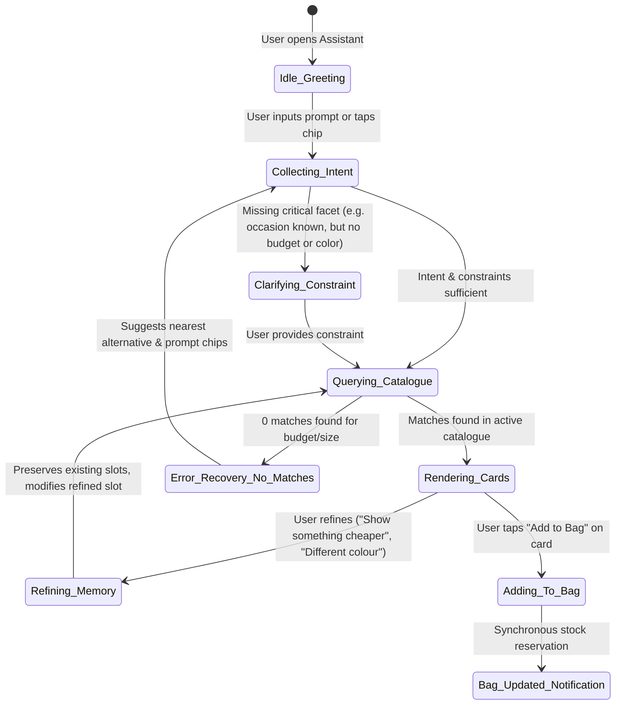
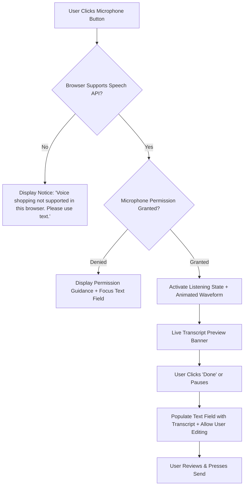

# AI Conversation Design & Conversational UX Architecture
**Project**: Berachtech E-Commerce AI OS (`BERACHTECH-ECOMMERCE-AI-OS`)  
**Phase**: UX-0 (Foundational Architecture & Conversation Design Specifications)  
**Standard**: NN/g Conversational UI Usability Guidelines, WCAG 2.2 AA (Live Regions), W3C Web Speech Standards  

---

## 1. Conversational Persona & Voice Guidelines

The AI Shopping Assistant is designed as a **knowledgeable, courteous, attentive personal shopping stylist in a boutique fashion salon**.

### Core Conversational Principles
1. **Human-Centred Simplicity**: Speaks like an empathetic human stylist. Never uses computer science or machine-learning terminology (strictly bans terms like *multimodal embeddings, vectors, token counts, agent orchestration, variant allocation, SKU lookup failure*).
2. **Conciseness & High Signal-to-Noise**: Never outputs long wall-of-text paragraphs. Answers are constrained to 1–2 crisp, warm sentences followed by visual, interactive product cards.
3. **Single-Question Efficiency**: Never bombards the customer with multiple questions at once. *"Do not ask five questions when one will do."*
4. **Contextual Memory & Constraint Retention**: Remembers previous attributes (e.g., occasion, preferred color, budget) across dialogue turns without requiring repetition.
5. **Multi-Modal Interaction**: Free text, suggestion chips, voice dictation, and direct button taps operate harmoniously together.

---

## 2. Conversational State Machine & Memory Architecture



### Conversational Memory Slot Schema
The conversational engine maintains an active slot object in local session state:

```typescript
interface ConversationSlotState {
  category: 'dress' | 'blazer' | 'top' | 'skirt' | 'all';
  occasion: string | null;       // e.g. "wedding", "cocktail", "workwear"
  color: string | null;          // e.g. "blue", "black", "navy"
  size: string | null;           // e.g. "UK 10", "UK 12", "M"
  maxPrice: number | null;       // e.g. 100.00
  styleAttributes: string[];     // e.g. ["sleeves", "midi", "wrap", "pleated"]
  selectedVariantId: string | null;
  lastQueryTime: number;
}
```

When a user refines their query (e.g., *"Show me something cheaper"*), the system mutates only `maxPrice` (decrementing to the next price tier, e.g., £75), preserving `category: 'dress'`, `occasion: 'wedding'`, and `color: 'blue'`.

---

## 3. Opening Experience & Suggestion Chips

### Initial Greeting State
* **Assistant Message**:
  > *"Hi! What are you shopping for today?"*
* **Persistent Suggestion Chips**:
  * `[Find a dress]`
  * `[Help me choose a size]`
  * `[Shop by budget]`
  * `[Find an outfit]`
  * `[Show similar styles]`
* **Input State**:
  * Free-text input field with placeholder: *"Ask for an outfit, style, colour, or budget..."*
  * Send button (`Enter` or clickable paper-plane icon)
  * Microphone icon for voice input (with hover label: *"Tap to speak"*)

---

## 4. Rich Interactive Component Specifications

Inside the conversational thread, responses render structured UI components rather than unstructured text:

### Component A: Conversational Product Card
* **Garment Thumbnail**: 120×150px crisp product image with zoom on hover.
* **Product Title**: High-contrast heading (e.g., *"Sapphire Satin Midi Dress"*).
* **Price Badge**: Highlighted price (e.g., `£85.00`), showing original strikethrough if discounted.
* **Color Dots**: Available color swatches with active ring indicator.
* **Size Availability Pills**: Visible pills showing available sizes (`UK 8`, `UK 10`, `UK 12`, `UK 14`), with out-of-stock sizes greyed out.
* **Action Buttons**:
  * `[View Details]`: Opens full PDP modal or navigates to page.
  * `[Add to Bag]`: Adds directly with currently selected variant without leaving chat.

### Component B: Contextual Refinement Action Bar
Below every product recommendation card group, the Assistant provides one-tap refinement pills:
* `[Show more like this]` &rarr; Fetches garments sharing stylistic tags.
* `[Different colour]` &rarr; Displays alternative colorways of the active garments.
* `[Lower price]` &rarr; Adjusts price ceiling downward.
* `[Change size]` &rarr; Prompts visible size buttons.
* `[Save for later]` &rarr; Adds to wishlist.

### Component C: Comparison Drawer
When the user asks *"Compare these two dresses"*, the Assistant renders a side-by-side comparison modal:
* Image side-by-side.
* Price, fabric composition, dress length (e.g. Midi vs. Maxi), neckline, and available sizes.
* Direct `[Select This One]` button below each column.

---

## 5. Voice Shopping UX Architecture

### Technical Foundation & Browser API
Voice shopping leverages the browser standard `webkitSpeechRecognition` / `SpeechRecognition` API with strict progressive enhancement.



### Voice Safety & Usability Rules
1. **Never Auto-Activate**: Voice recording is strictly opt-in. The microphone never activates without an explicit user click.
2. **Permission Explanation**: Clicking the microphone displays a clear tooltip: *"We use your browser's speech recognition to transcribe your shopping request. No audio is recorded or stored."*
3. **Visible Listening State**: During recording, the microphone icon pulses in vivid violet (`#7C3AED`) with an accessible status indicator (*"Listening... Speak now"*).
4. **Editable Transcript Preview**: Recognised speech is streamed into an editable text box. The customer can review, fix misheard words, or cancel before sending.
5. **Graceful Fallback**: If speech is unsupported or permission is denied, the interface falls back to keyboard typing without any broken state or alert popups.

---

## 6. Comprehensive Dialogue Scripts for Usability Test Scenarios

### Script 1 (Test A): "Find a black dress under £100"
* **User**: `"I'm looking for a black dress under £100 for an evening event."`
* **Assistant**:
  > *"Here are three stylish black evening dresses within your £100 budget:"*
* **Rendered UI**:
  * 3 Product Cards:
    1. *Noir Pleated Halter Midi* — `£88.00` (Sizes: UK 8, UK 10, UK 12, UK 14)
    2. *Midnight Velvet Slip Dress* — `£95.00` (Sizes: UK 10, UK 12)
    3. *Classic Column Crepe Dress* — `£79.00` (Sizes: UK 8, UK 10, UK 12, UK 16)
  * Action Chips: `[Show more like this]` `[Different colour]` `[Lower price]` `[Change size]`

### Script 2 (Test B): "Change colour and size"
* **User**: `"Do you have the Noir Pleated dress in emerald green and size UK 14?"`
* **Assistant**:
  > *"Yes! We have the Noir Pleated Halter in Emerald Green available in size UK 14."*
* **Rendered UI**:
  * Product Card:
    * Image: Emerald Green variant.
    * Color: `Emerald Green` (Active swatch).
    * Size: `UK 14` (Highlighted in violet).
    * Price: `£88.00` — `In Stock (4 available)`.
  * Primary Button: `[Add to Bag — UK 14 / Emerald Green]`.

### Script 3 (Test C): "Alternative recommendation when size is unavailable"
* **User**: `"Can I get that in size UK 8?"`
* **Assistant**:
  > *"Size UK 8 in Emerald Green is currently out of stock. We have UK 8 in Midnight Navy, or you could consider the Emerald Velvet Slip which is available in UK 8. Would you like to see either?"*
* **Rendered UI**:
  * 2 Alternative Option Cards:
    1. *Noir Pleated Halter (Midnight Navy, Size UK 8)* — `£88.00`
    2. *Emerald Velvet Slip (Emerald Green, Size UK 8)* — `£92.00`
  * Action Chip: `[Notify me when Emerald Green UK 8 returns]`

### Script 4 (Test D): "Use AI to add product to basket directly from conversation"
* **User**: `"Add the Emerald Velvet Slip to my bag please."`
* **Assistant**:
  > *"Added! Emerald Velvet Slip (UK 8, Emerald Green) has been placed in your bag. Your temporary stock hold is active for 15 minutes."*
* **Rendered UI**:
  * Confirmation Card with Bag Subtotal (`£92.00`) and Delivery status (`Free Standard Delivery`).
  * Action Buttons: `[View Bag & Checkout]` or `[Keep Shopping]`.
  * Cart drawer badge increments to `(1)` with subtle accessible animation.

### Script 5: Edge-Case Handling & Conversational Reset
* **User**: `"What is the weather in London tomorrow?"` (Out-of-scope query)
* **Assistant**:
  > *"I'm your fashion shopping assistant, so I can only help with our clothing collection, sizing, and orders! Can I help you find an outfit for the London weather?"*
* **Prompt Chips**: `[Dresses with sleeves]` `[Coats & Outerwear]` `[Browse collection]`

---

## 7. Accessibility Specifications for Conversational UI

1. **`aria-live="polite"` Regions**: The chat message log container is marked with `aria-live="polite"` and `aria-atomic="false"`. Incoming assistant messages and card announcements are read sequentially without interrupting active user input.
2. **Keyboard Focus Flow**: Sending a message keeps keyboard focus within the input field for continuous typing, while pressing `Shift+Tab` cycles backwards directly to the newly rendered product cards.
3. **Esc Key Behavior**: Pressing `Escape` anywhere within the conversational modal cleanly dismisses it, restoring focus to the original triggering button.
4. **Screen Reader Card Labels**: Every product card uses an accessible container label:  
   `aria-label="Product: Sapphire Satin Midi Dress, £85.00, In Stock, Sizes UK 8 through 14 available"`.
