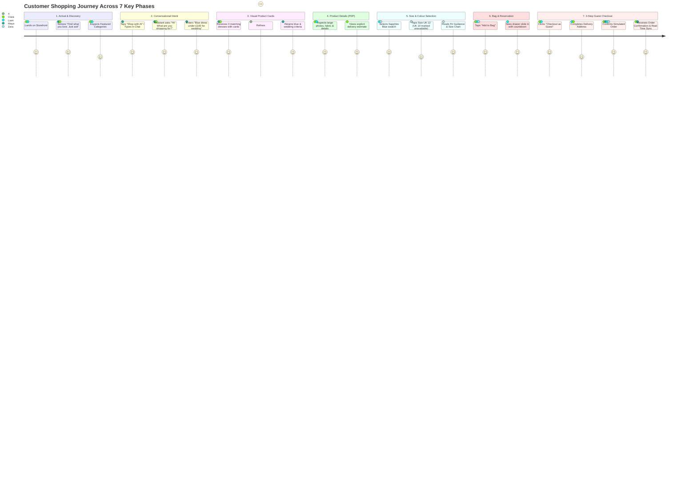

# Customer Journey Map: Human-Centred End-to-End Shopping Experience
**Project**: Berachtech E-Commerce AI OS (`BERACHTECH-ECOMMERCE-AI-OS`)  
**Phase**: UX-0 (Foundational Architecture & User Experience Specifications)  
**Target Personas**: Persona A (First-Time Shopper), Persona B (Conversational Shopper), Persona C (Mobile Shopper), Persona D (Size-Uncertain Shopper)  
**Standard**: WCAG 2.2 AA, Baymard E-Commerce UX Best Practices, NN/g Usability Principles  

---

## 1. Customer Personas Architecture

### Persona A: First-Time Online Shopper ("Clara", Age 58)
* **Demographics & Context**: Browses on an iPad or desktop laptop; infrequently buys clothing online due to fear of hidden charges, poor sizing, or complicated navigation.
* **Core Needs**: Clear, large typography; obvious prices with zero hidden fees; simple visual categories; transparent returns and shipping timeline; high confidence before clicking purchase.
* **Frustrations**: Unresponsive chatbots; pop-up newsletters; small unreadable text; complicated multi-step menus.

### Persona B: Conversational Shopper ("Maya", Age 29)
* **Demographics & Context**: Tech-savvy professional shopping during a commute or lunch break; seeks curated outfits for specific occasions (e.g. summer wedding, office gala).
* **Core Needs**: Natural-language communication; prompt recommendations without having to filter 400 catalog pages; quick refinement ("something a bit more formal, under £120").
* **Frustrations**: Chatbots that output walls of text without actionable links; bots that forget previous constraints; rigid multiple-choice decision trees.

### Persona C: Mobile Shopper ("Liam", Age 24)
* **Demographics & Context**: Uses an iPhone 14 with one hand while on the move; prefers tap over typing; values speed and visual clarity.
* **Core Needs**: Large touch targets (>= 44px); bottom-sheet navigation; sticky shopping bag bar; instant visual feedback; minimal form typing.
* **Frustrations**: Accidental taps on micro-buttons; sticky headers that conceal content; horizontal scrollbars; modal dialogs that cannot be closed.

### Persona D: Size-Uncertain Shopper ("Zara", Age 35)
* **Demographics & Context**: Experiences fluctuating sizing between brands (often between UK 10 and UK 12); hesitant to buy apparel without fit clarity.
* **Core Needs**: Visible size selector pills (not hidden in dropdowns); clear UK size charts with metric and imperial measurements; stretch and fabric descriptions; clear recommendations when a size is out of stock.
* **Frustrations**: Vague size dropdowns; discovering a size is sold out only after clicking "Add to Bag"; complicated returns policies.

---

## 2. End-to-End Customer Journey Stages

---

## 3. Comprehensive Stage-by-Stage Journey Breakdown

### Stage 1: Arrival & Visual Onboarding
* **Customer Mindset**: *"Am I in the right place? Is this collection high quality and easy to navigate?"*
* **Touchpoints**:
  * Clean, calm hero banner: *"Find what you love. Just ask."*
  * Supporting copy: *"Tell our shopping assistant what you're looking for, or explore the collection yourself."*
  * Dual primary CTAs: `[Shop with AI]` (Violet fill) and `[Browse Collection]` (Outlined neutral).
  * Prominent delivery & returns assurance badge: *"Free UK Delivery over £50 • 30-Day Hassle-Free Returns"*.
  * Curated product carousel showcasing New Arrivals and Trending Occasions.
* **System Actions**:
  * Loads fast, zero layout shift (CLS < 0.05).
  * Initializes anonymous local guest session and cart token.
  * Displays "Simulated Data" non-obtrusive indicator.
* **UX Interventions**:
  * No aggressive modal popups or email subscription takeovers.
  * Prominent, accessible top navigation: `Home`, `Shop`, `Categories`, `New Arrivals`, `Shop with AI`, `My Bag (0)`.
  * Mobile view anchors sticky assistant bubble at bottom-right for instant thumb access.

### Stage 2: Conversational Consultation & Intent Formulation
* **Customer Mindset**: *"I want something specific for an event, but I don't want to dig through 20 search pages."*
* **Touchpoints**:
  * AI Shopping Assistant window launches smoothly (modal dialog on desktop, bottom-sheet / full viewport on mobile).
  * Opening greeting: *"Hi! What are you shopping for today?"*
  * Suggested prompt chips:
    * `[Find a dress]`
    * `[Help me choose a size]`
    * `[Shop by budget]`
    * `[Find an outfit]`
    * `[Show similar styles]`
  * Unrestricted free-text input with microphone button for voice dictation.
* **Customer Interaction**:
  * Customer inputs: *"I need something elegant for a wedding."*
  * Assistant responds concisely: *"Of course! Do you have a preferred colour or budget?"*
  * Customer replies: *"Something blue, under £100."*
* **System Actions**:
  * Intent parsing extracts: `category: dress`, `occasion: wedding`, `color: blue`, `max_price: 100`.
  * Preserves slot parameters in conversation state.
  * Queries demo catalogue filtering active stock matching constraints.
* **UX Interventions**:
  * Never asks multiple redundant questions when one suffices.
  * Voice dictation displays real-time transcript with an `[Edit]` button before submission.
  * Speech synthesis is completely optional and muted by default.

### Stage 3: Visual Product Cards in Conversation
* **Customer Mindset**: *"Show me what it looks like; don't give me a paragraph of text."*
* **Touchpoints**:
  * Conversational header: *"Here are 3 elegant options within your £100 budget:"*
  * Grid of 3 interactive visual product cards containing:
    * High-resolution primary garment image.
    * Product title: *"Sapphire Satin Midi Dress"*.
    * Price: `£85.00` (highlighted in high contrast).
    * Colorway indicator dots: `Midnight Navy`, `Sapphire Blue`.
    * Size pill indicators: `UK 8`, `UK 10`, `UK 12`, `UK 14`.
    * Availability status: `In Stock`.
    * Actions: `[View Details]` and `[Add to Bag]`.
  * Contextual adjustment chips:
    * `[Show more like this]`
    * `[Different colour]`
    * `[Lower price]`
    * `[Change size]`
* **Customer Interaction**:
  * Customer says: *"Show me something cheaper."*
* **System Actions**:
  * Retains `occasion: wedding` and `color: blue`, filters catalogue for price `<= £70.00`.
  * Renders updated cards instantly with smooth crossfade.
* **UX Interventions**:
  * Eliminates walls of text. Cards are compact, horizontally scrollable on mobile, and fully keyboard accessible.

### Stage 4: Product Detail Page (PDP) & Trust Building
* **Customer Mindset**: *"What is the material? How will it fit my body? How quickly will it arrive?"*
* **Touchpoints**:
  * High-resolution image gallery (front, back, model moving, fabric macro texture).
  * Prominent product header: *"Azure Pleated Wrap Maxi Dress"* • `£95.00`.
  * Star rating with simulated verified customer reviews count.
  * Fabric & Care expandable panel: *"100% Recycled Satin Crepe • Dry Clean Only"*.
  * Fit & Model panel: *"Model is 5'9" wearing UK 10. True to size with gentle waist drape"*.
  * Delivery guarantee box: *"Order within 3 hrs for delivery by Thursday, Oct 16"*.
  * Direct action: `[Ask AI about this product]`.
* **UX Interventions**:
  * Essential purchasing information is never hidden in sub-menus.
  * Secondary specifications use accessible `
` / `
` accordions.

### Stage 5: Size & Colour Selection (Variant Resolution)
* **Customer Mindset**: *"I hope they have my size in stock and the color matches my expectations."*
* **Touchpoints**:
  * Colour Swatches: Circular 44×44px swatches for `Royal Blue`, `Midnight Navy`, `Forest Green`.
  * Active Color Label: *"Colour: Royal Blue (Selected)"*.
  * Visible Size Matrix: Direct button pills for `UK 8`, `UK 10`, `UK 12`, `UK 14`, `UK 16`.
  * Status: `UK 10` is marked as sold out with a diagonal strike and subtle grey tint.
  * When `UK 10` is focused/hovered, tooltip displays: *"Size UK 10 is currently out of stock. Would you like size UK 12 or notify when restocked?"*
  * Size Guide Drawer link: Launches interactive measurement comparison table (Bust, Waist, Hips in cm & inches).
* **System Actions**:
  * Selecting a swatch updates the hero image and verifies stock for all sizes in that colorway.
  * Validates variant ID (`SKU-BLU-12`) and locks temporary price.
* **UX Interventions**:
  * No dropdowns for sizing.
  * Full keyboard arrow-key navigation between sizes (roving tabindex).
  * System never guesses user measurements or guarantees fit.

### Stage 6: Bag Reservation & Cart Drawer
* **Customer Mindset**: *"I'm ready to buy; let me review what I'm ordering."*
* **Touchpoints**:
  * Customer clicks `[Add to Bag]`.
  * Screen reader announces: *"Azure Pleated Wrap Maxi Dress, Size UK 12, added to your shopping bag."*
  * Slide-over Bag Drawer opens with smooth ease-out animation.
  * Bag Drawer displays:
    * Garment thumbnail, title, selected color, selected size, and unit price.
    * Inline quantity stepper: `[-] [ 1 ] [+]`.
    * Stock Hold notification: *"Items reserved for 15:00 minutes"*.
    * Subtotal, estimated standard delivery (`FREE`), and grand total.
    * Primary CTA: `[Proceed to Guest Checkout]`.
    * Secondary action: `[Continue Shopping]`.
* **UX Interventions**:
  * Cart drawer can be dismissed by clicking backdrop, pressing `Escape`, or tapping close icon.
  * Focus shifts directly to primary checkout action for rapid keyboard progression.

### Stage 7: 3-Stage Guest Checkout & Real-Time Fulfillment Sync
* **Customer Mindset**: *"I want to check out quickly without creating another annoying password."*
* **Touchpoints**:
  * Breadcrumb progress indicator:
    * `Step 1: Bag` (Completed / Green Checkmark)
    * `Step 2: Delivery Details` (Active)
    * `Step 3: Review & Confirm` (Pending)
  * Prominent banner: *"Guest Checkout — No Account Required"*.
  * Streamlined delivery form:
    * Full Name
    * Email (for simulated order confirmation)
    * Street Address
    * City & Postcode
  * Delivery Method selection:
    * `Standard Delivery (2-3 Days) — FREE`
    * `Next Day Priority — £4.99`
  * Step 3 Review & Confirm:
    * Full breakdown of items, sizes, shipping address, and final total.
    * Simulated Payment section (Clearly marked: *"Simulated Payment — No Real Card Charged"*).
    * Single-click button: `[Confirm Simulated Purchase - £95.00]`.
    * Duplicate submission safeguard (button disables and shows spinner upon first tap).
* **System Actions**:
  * Generates unique simulated Order ID (e.g., `#BER-84219`).
  * Decrements variant inventory in shared simulated state store.
  * Instantly emits order notification to Merchant Dashboard (`What Needs Your Attention?`).
  * Renders rich Order Confirmation screen with order breakdown, estimated delivery date, and `[View in Merchant Dashboard]` shortcut.

---

## 4. Friction Prevention & Usability Safeguards Summary

| Potential Journey Friction | UX Safeguard & Architectural Mechanism | Verification Criterion |
| :--- | :--- | :--- |
| **User feels overwhelmed on homepage** | Minimalist hero with two clear paths: AI styling vs. catalogue browsing. Calm visual palette. | 0 popups; first screen scannable in < 3 seconds. |
| **Assistant misunderstands conversational intent** | Assistant politely asks one clarifying question; provides prompt chips to re-anchor dialogue. | Recovery path offered in 100% of ambiguous inputs. |
| **Wrong size ordered due to vague sizing** | Visible UK size buttons with out-of-stock badges + explicit measurement guide drawer. | Zero hidden sizes in dropdowns. |
| **Cart abandonment at checkout** | Guest checkout prominent by default. Exactly 3 steps. No password creation required. | Checkout completion reachable in 3 sequential steps. |
| **Double clicks causing multiple orders** | Submit button disables immediately on click with loading spinner and debounce guard. | Strict idempotent order creation handler. |
