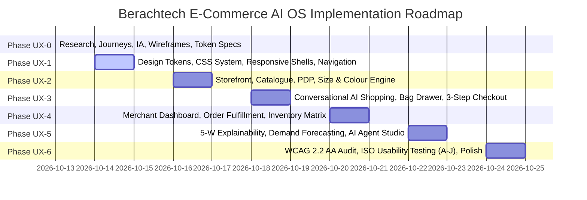

# Berachtech E-Commerce AI OS: UX Architecture Index & Phase Roadmap
**Project**: Berachtech E-Commerce AI OS (`BERACHTECH-ECOMMERCE-AI-OS`)  
**Specification**: Human-Centred UX/UI Master Amendment V2  
**Current Phase**: Phase UX-0 (Foundational Research, User Journeys, Architecture & Acceptance Criteria)  
**Status**: UX-0 Complete & Validated  

---

## 1. Documentation Index & Structural Guide

| Document | Primary Focus & Coverage | Target Standards |
| :--- | :--- | :--- |
| **[UX Research & Design Decisions](file:///Users/jithuvarghese/Documents/mine/e%20commerce%20/docs/UX_RESEARCH_AND_DESIGN_DECISIONS.md)** | NN/g heuristics, Baymard PDP & checkout research, WCAG 2.2 analysis, decision registers, 13 error recovery states, demo disclosures. | NN/g, Baymard, WCAG 2.2 AA |
| **[Customer Journey Map](file:///Users/jithuvarghese/Documents/mine/e%20commerce%20/docs/CUSTOMER_JOURNEY_MAP.md)** | End-to-end customer journey for Personas A–D across 7 stages (Discovery, Conversational Intent, Visual Cards, PDP, Size/Color, Bag, 3-Step Guest Checkout). | Baymard Guest Checkout, WCAG 2.5.8 |
| **[Merchant Journey Map](file:///Users/jithuvarghese/Documents/mine/e%20commerce%20/docs/MERCHANT_JOURNEY_MAP.md)** | Deep dark-purple sidebar ergonomics, 5-second business scan, *"What Needs Your Attention?"* feed, 5-W Explainability model, human-in-the-loop gates. | ISO 9241-210, Explainable AI |
| **[AI Conversation Design](file:///Users/jithuvarghese/Documents/mine/e%20commerce%20/docs/AI_CONVERSATION_DESIGN.md)** | Personal boutique stylist persona, slot memory architecture, visual cards, Web Speech API integration, dialog scripts for Scenarios A–D. | NN/g Conversational UI, W3C Speech |
| **[Application Information Architecture](file:///Users/jithuvarghese/Documents/mine/e%20commerce%20/docs/APPLICATION_INFORMATION_ARCHITECTURE.md)** | Dual-portal sitemaps (Storefront vs. Merchant), progressive disclosure hierarchy, shared reactive state schema, responsive breakpoints. | Information Architecture & Routing |
| **[Low-Fidelity Wireframes](file:///Users/jithuvarghese/Documents/mine/e%20commerce%20/docs/LOW_FIDELITY_WIREFRAMES.md)** | Detailed structural wireframes for Desktop & Mobile Storefront, AI Assistant modal, PDP, Bag Drawer, 3-Step Checkout, and Merchant Dashboard. | Responsive Design, 44px Touch Targets |
| **[Design Tokens Specification](file:///Users/jithuvarghese/Documents/mine/e%20commerce%20/docs/DESIGN_TOKENS.md)** | Semantic and primitive color palettes, typography scale, 4px spacing grid, elevation shadows, radii, and WCAG focus-visible indicators. | WCAG 1.4.3 & 2.4.11 |
| **[Accessibility Plan](file:///Users/jithuvarghese/Documents/mine/e%20commerce%20/docs/ACCESSIBILITY_PLAN.md)** | Comprehensive strategy across all 4 WCAG principles: contrast, non-color cues, 100% keyboard flow, ARIA live regions, VoiceOver/NVDA checklists. | WCAG 2.2 Level AA |
| **[Usability Test Plan](file:///Users/jithuvarghese/Documents/mine/e%20commerce%20/docs/USABILITY_TEST_PLAN.md)** | Detailed testing protocols for Scenarios A through J, ISO 9241 metrics (effectiveness, efficiency, satisfaction), pass criteria, and observation scorecards. | ISO 9241-11 Usability Metrics |
| **[Feature Coverage Matrix](file:///Users/jithuvarghese/Documents/mine/e%20commerce%20/docs/ECOMMERCE_AI_UX_FEATURE_COVERAGE.md)** | Exhaustive 30-feature traceability matrix linking user types, business purpose, screens, actions, data dependencies, error handling, and test cases. | Requirements Traceability |

---

## 2. Implementation Phase Roadmap (UX-0 through UX-6)

* **PHASE UX-0 (Completed)**: Foundational research, user journeys, information architecture, wireframes, design tokens, accessibility plan, usability test plan, and feature coverage matrix.
* **PHASE UX-1**: Implementation of design system tokens (`tokens.css`), responsive layout shells, navigation bars, and cross-portal routing.
* **PHASE UX-2**: Storefront catalog, filtering rails, product detail page, high-resolution gallery, visible size buttons, dual-color swatches, and size guide drawer.
* **PHASE UX-3**: Conversational AI assistant dialogue engine, slot memory, visual cards, Web Speech voice input, slide-over bag drawer, and 3-step guest checkout.
* **PHASE UX-4**: Merchant dark-purple dashboard shell, 6 executive KPI cards, *"What Needs Your Attention?"* feed, order packing/dispatch queue, and inventory stock matrix.
* **PHASE UX-5**: AI intelligence hub, the 5-W explainability proposal modal, human approval gates (approve/reject/edit/undo), illustrative demand forecasting curves, and agent rules.
* **PHASE UX-6**: Automated Axe-core and Lighthouse accessibility auditing, full keyboard walkthrough, screen reader validation, and empirical execution of Usability Scenarios A through J.
