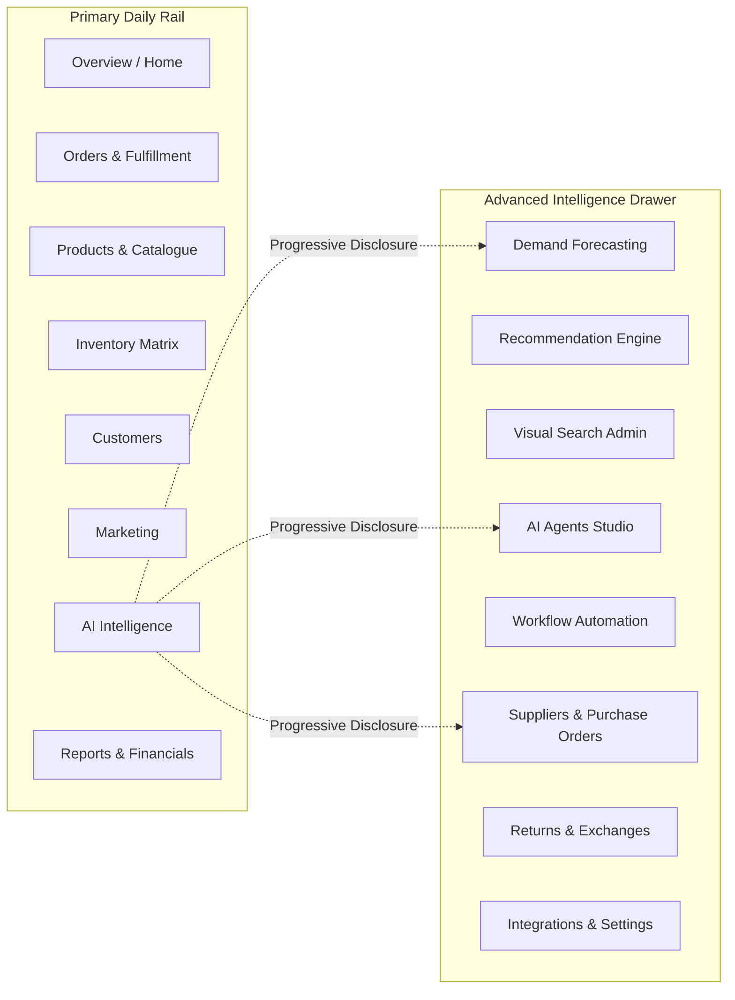
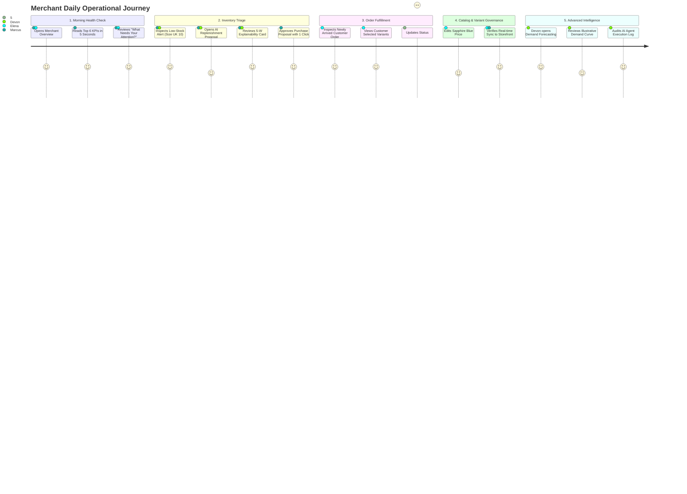

# Merchant Journey Map: Human-Centred Retail Administration & AI Governance
**Project**: Berachtech E-Commerce AI OS (`BERACHTECH-ECOMMERCE-AI-OS`)  
**Phase**: UX-0 (Foundational Architecture & User Experience Specifications)  
**Target Personas**: Persona E (Small Business Owner), Persona F (Retail Operations Manager), Persona G (Advanced Merchant User)  
**Visual & Functional Standard**: Deep dark-purple sidebar rail, light workspace, progressive disclosure, 5-W Explainable AI, human approval gates  

---

## 1. Merchant Personas Architecture

### Persona E: Small Business Owner ("Marcus", Age 46)
* **Profile**: Boutique owner running an independent fashion brand; manages buying, store operations, and finances with a small 3-person team.
* **Core Needs**: Instant grasp of business health within 5 seconds of opening the dashboard; plain English instead of corporate jargon; zero coding or machine-learning knowledge required.
* **Key Tasks**: Seeing today's sales, knowing which orders must be packed this morning, and reordering low-stock dresses before the weekend.
* **Frustrations**: Complex software with 50 unlabelled buttons; AI systems that execute price cuts without asking; impenetrable data tables.

### Persona F: Retail Operations Manager ("Elena", Age 34)
* **Profile**: Experienced retail operator supervising order processing, returns, stock allocations, and carrier dispatch.
* **Core Needs**: High-density clean tables with sorting, filtering, and bulk status updates; low-latency order updates; automated packing slips; transparent tracking numbers.
* **Key Tasks**: Filtering orders by fulfillment status (`Pending`, `Packed`, `Dispatched`); auditing return requests; flagging supplier shipment delays.
* **Frustrations**: Slow page reloads; lack of undo controls; disjointed inventory matrices where variant stock cannot be updated inline.

### Persona G: Advanced Merchant User ("Devon", Age 39)
* **Profile**: Growth director and merchandise planner focusing on margin optimization, seasonal demand forecasting, and automated replenishment.
* **Core Needs**: Predictive intelligence; scenario simulation ("What if demand surges 20% next week?"); guardrails for automated workflows; granular audit trails.
* **Key Tasks**: Reviewing AI forecasting trends; tuning safety stock buffers; evaluating AI agent action proposals.
* **Frustrations**: Black-box predictions with no explanation; systems that claim 100% forecasting certainty; lack of override switches.

---

## 2. Visual Direction & Dashboard Information Architecture

### Visual Ergonomics
* **Sidebar**: Deep dark-purple (`#160B22` background, `#1B0E29` border) providing high visual contrast and calm focus.
* **Active Navigation**: Vibrant violet pill (`#7C3AED` with `#F5F3FF` text and 12px pill curvature).
* **Workspace**: Crisp, high-contrast light surface (`#F8FAFC` base, `#FFFFFF` cards) with soft diffused drop-shadows (`0 4px 20px -2px rgba(27, 14, 41, 0.05)`).
* **Typography**: Modern humanist sans-serif with clear optical weights (Inter display weights for metrics, neutral tabular numerals for financial data).

### Two-Tier Navigation with Progressive Disclosure
To prevent cognitive overload, the navigation separates daily core operational tasks from deep advanced intelligence:

---

## 3. End-to-End Merchant Operational Journey

---

## 4. Stage-by-Stage Operational Workflow

### Stage 1: Morning Briefing & 5-Second Health Overview
* **Merchant Mindset**: *"How did we perform overnight? Do I have enough stock? Are there urgent fires to put out?"*
* **Top Metric Cards (Instant 5-Second Scan)**:
  1. **Sales Today**: `£1,842.50` (`+12.4% vs last Tuesday`)
  2. **Orders Today**: `24 orders` (`18 completed, 6 pending`)
  3. **Average Order Value (AOV)**: `£76.77`
  4. **Pending Fulfillment**: `5 orders waiting to be packed` (Highlighted with amber pill badge)
  5. **Low-Stock Products**: `3 variants below threshold` (Highlighted with crimson pill badge)
  6. **Simulated Return Rate**: `1.8%` (Healthy benchmark)
* **UX Interventions**:
  * Clean, rounded KPI cards with large tabular numbers.
  * Direct trend sparklines indicating 7-day trajectory.
  * Clear label: *"SIMULATED DATA — Real-time Demo Engine"*.

### Stage 2: "What Needs Your Attention?" Priority Feed
* **Merchant Mindset**: *"Tell me exactly what requires my decision right now."*
* **Priority Alert Items**:
  * **Alert 1: Low-Stock Urgent Warning**:  
    *"Size UK 10 in Sapphire Satin Midi Dress has 2 units remaining."*  
    *Action*: `[Review Stock & Reorder]`
  * **Alert 2: Orders Pending Packing**:  
    *"5 orders from overnight are awaiting dispatch before 2:00 PM."*  
    *Action*: `[Open Packing Queue]`
  * **Alert 3: Demand Surge Trend**:  
    *"Simulated demand for evening cocktail dresses is projected to rise 22% next week."*  
    *Action*: `[View Forecast]`
* **UX Interventions**:
  * Alerts are sorted by financial/fulfillment urgency.
  * Every alert includes a direct, single-click verb action button that opens the relevant workflow modal or filter.

### Stage 3: AI Explainability (The 5-W Model in Action)
* **Merchant Mindset**: *"Why does the AI want me to order 30 more units of this dress? Can I trust it?"*
* **Workflow**: Merchant clicks `[Review Stock & Reorder]` on Alert 1.
* **The 5-W Explainability Card Renders**:
  1. **WHAT (Recommendation)**:  
     *"Create a simulated purchase order for 25 units of Sapphire Satin Midi Dress (Size UK 10) from supplier Atelier Silk Co."*
  2. **WHY (Empirical Evidence)**:  
     *"Daily sales velocity for this variant is 3.8 units/day. Current stock of 2 units will deplete within ~12 hours. Supplier lead time is 4 days."*
  3. **IMPACT (Projected Outcome)**:  
     *"Prevents an estimated £2,125.00 in lost revenue over the coming 7 days."*
  4. **ACTION (Interactive Human Controls)**:  
     * Primary: `[Approve Purchase Order — £625.00]`
     * Secondary: `[Edit Quantity / Supplier]`
     * Decline: `[Decline Recommendation]`
  5. **LIMITATIONS (Uncertainty Disclosure)**:  
     *"Illustrative forecast based on simulated historical velocity; does not account for external weather or unmodelled competitor promotions."*
* **UX Interventions**:
  * No hidden logic.
  * Complete transparency prevents blind automation and fosters trust.

### Stage 4: Human-in-the-Loop Governance & Multi-Action Controls
* **Merchant Mindset**: *"I am in charge. The software works for me, not the other way around."*
* **Mandatory Approval Gates**:
  * Price changes (e.g. promotional discounts or dynamic markdowns) require explicit merchant confirmation.
  * Supplier purchase orders require 1-click confirmation with inline quantity editing.
  * Customer refunds and cancellations require supervisor review.
  * Mass marketing campaigns require draft preview and sign-off.
* **Interactive Control Bar**:
  * `[Approve]`: Executes action, updates simulated ledger, and creates audit entry.
  * `[Edit]`: Opens an inline drawer allowing the merchant to change quantity (e.g., reduce from 25 to 15) or change delivery date.
  * `[Reject]`: Dismisses recommendation and asks for optional 1-click feedback (*"Price too high"*, *"Discontinuing line"*).
  * `[Undo]`: Available for 60 seconds after execution via persistent toast notification.
* **Audit Trail**: Full chronological log records: Timestamp, Action Type, Original AI Proposal, Modified Values, Approving User ID, and Status.

### Stage 5: Real-Time Order Management & Fulfillment
* **Merchant Mindset**: *"A new order just arrived from the customer storefront. Let me process it immediately."*
* **Workflow**:
  1. Real-time badge updates: `Orders (1 New)`.
  2. Elena clicks `Orders` &rarr; sees Order `#BER-84219` (Azure Pleated Wrap Maxi Dress, UK 12, Sapphire Blue, £95.00).
  3. Table displays customer name ("Clara Higgins"), items count (1), delivery method ("Standard"), payment status ("Simulated Paid"), and fulfillment status ("Unfulfilled").
  4. Elena clicks `[Pack Order]` &rarr; status updates to `"Packed"`.
  5. Elena clicks `[Mark Dispatched]` &rarr; input prompts simulated tracking number (`GB-99214-POST`).
  6. Toast notification confirms: *"Order #BER-84219 marked as dispatched"*.

### Stage 6: Predictive Intelligence & Demand Forecasting (Advanced User)
* **Merchant Mindset**: *"What does our inventory outlook look like for the upcoming season?"*
* **Workflow**: Devon opens `AI Intelligence` &rarr; `Demand Forecasting`.
* **Visual Presentation**:
  * Interactive 30-day forecast graph comparing Historical Sales (solid line), Projected Baseline (dashed line), and Upper/Lower Confidence Intervals (shaded lilac ribbon).
  * Clear badge: *"ILLUSTRATIVE FORECAST — Model: Holt-Winters Smoothing Simulation"*.
  * Category toggle pills: `Evening Dresses`, `Casual Wear`, `Accessories`.
  * Stockout Risk Matrix: Table ranking products by days of remaining cover (`Drape Maxi: 2 days`, `Tailored Blazer: 14 days`, `Silk Blouse: 45 days`).

---

## 5. Merchant Usability Safeguards & Heuristic Validation

| Heuristic / Usability Need | Architectural Mechanism | Verification Criterion |
| :--- | :--- | :--- |
| **5-Second Business Grasp** | 6 high-contrast KPI cards with sparklines and priority alert banner at top of viewport. | Key metrics understood without scrolling on 1080p desktop. |
| **Operational Safety (No Accidental Actions)** | Confirmation modals on financial/inventory actions; prominent 60-second undo toast. | 0 permanent destructive mutations without confirmation. |
| **High Table Legibility** | Sticky table headers, alternating row hover highlights, clear status pill colors, and keyboard pagination. | Meets WCAG 1.4.3 text contrast >= 4.5:1. |
| **Multi-Tier Navigation Simplicity** | 8 primary tabs in clean sidebar; advanced AI & integrations tucked into expandable intelligence module. | Low visual clutter; zero nested 3rd-level menu traps. |
| **Real-Time Cross-Portal Sync** | Shared reactive client state store; customer purchases update merchant inventory immediately. | Customer checkout reflects in merchant order list in < 500ms. |
