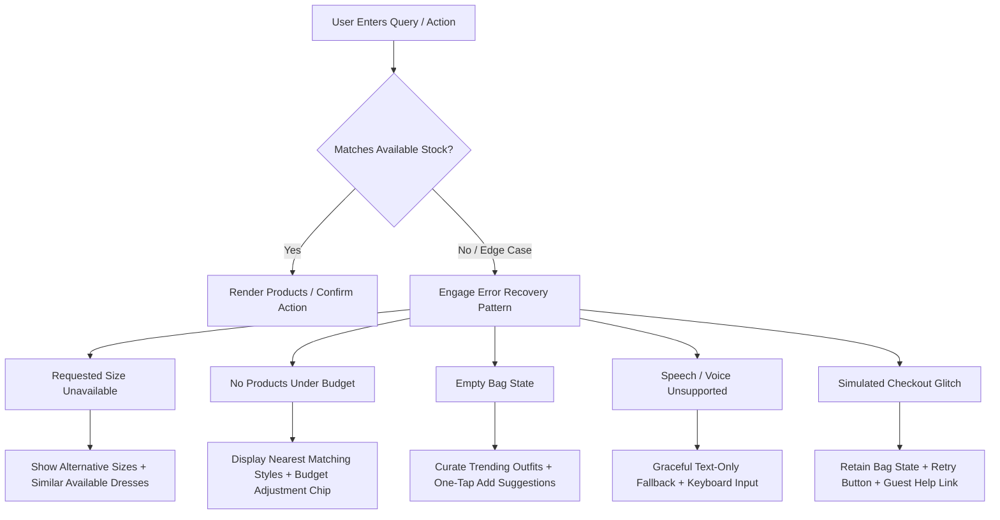

# UX Research & Design Decisions: Human-Centred UX/UI Architecture
**Project**: Berachtech E-Commerce AI OS (`BERACHTECH-ECOMMERCE-AI-OS`)  
**Phase**: UX-0 (Foundational Research, User Journeys, Architecture & Acceptance Criteria)  
**Author**: Berachtech Senior UX Research, Conversational AI & Engineering Group  
**Target Compliance**: Nielsen Norman Group Usability Standards, Baymard Institute Benchmarks, WCAG 2.2 Level AA  

---

## 1. Executive Summary & Design Philosophy

The Berachtech E-Commerce AI OS is designed from the premise that **a first-time visitor should intuitively understand what to do next without instructions, onboarding tooltips, or technical training**. Whether the user is a fashion customer seeking an evening dress or a small business owner reviewing daily fulfillment, the interface prioritizes human intention over technical mechanics.

### Core Architectural Axioms
1. **Clarity over Complexity**: Plain, conversational language replaces algorithmic jargon.
2. **Function over Decoration**: Every layout element serves a clear task; decorative visual elements never impede touch targets or reading flow.
3. **Recognition over Recall**: Visual cues, persistent preferences, and visible option chips eliminate the need for users to remember prior steps or variant codes.
4. **Control over Automation**: The AI assists, recommends, and drafts actions, but never finalizes financial, legal, or inventory modifications without explicit human approval.
5. **Trust over Exaggeration**: Transparent disclosures ("Simulated Data", "Illustrative Forecast", "Demo Shopping Assistant") set honest expectations and build durable trust.
6. **Progressive Disclosure over Clutter**: Primary goals and critical signals occupy the focal plane; advanced configuration and deeper analytical dimensions reveal themselves on demand.

### Technical & Conversational Vocabulary Transformation
To maintain psychological safety and cognitive ease, all system communications are translated into everyday human language:

| Prohibited Technical Jargon | Mandatory Human-Centred Replacement | User Benefit |
| :--- | :--- | :--- |
| "Execute semantic multimodal retrieval" | *"Find something similar"* | Reduces intimidation; sets intuitive mental model. |
| "Initiate variant allocation workflow" | *"Choose your size and colour"* | Mirrors traditional in-store shopping behavior. |
| "Invoke autonomous commerce agent" | *"Ask the shopping assistant"* | Communicates helpful service rather than black-box automation. |
| "Inventory delta reorder trigger" | *"Low-stock alert: 3 units left"* | Immediate clarity on urgency without supply chain jargon. |
| "Vector similarity distance: 0.89" | *"Stylist match based on your blue evening theme"* | Clear attribution of recommendations to customer input. |
| "Session cookie persisted basket state" | *"Saved to your bag"* | Clear, standard e-commerce affordance. |

---

## 2. Foundational Research Synthesis

Our UX strategy synthesizes findings across four premier usability and accessibility bodies:

### A. Nielsen Norman Group (NN/g) Usability Heuristics
1. **Visibility of System Status (#1)**: Users must always know system state (e.g., active filters, items in bag, assistant thinking state with subtle animated dots, stock reservation countdown).
2. **Match Between System and the Real World (#2)**: Using metaphors of a high-end personal boutique assistant, clothing racks, size tags, and shopping bags rather than database queries and SKU rows.
3. **User Control and Freedom (#3)**: Unrestricted escape hatches. Users can switch instantly between AI chat and traditional category browsing; undo stock updates; edit basket quantities inline; and dismiss modals via standard keystrokes (`Escape`).
4. **Consistency and Standards (#4)**: Standard placement of shopping bag (top-right), search/assistant trigger, standard size progression (`XS` through `XL` / `UK 8` through `UK 14`), and universal checkout stages (`Bag` &rarr; `Delivery` &rarr; `Review & Confirm`).
5. **Error Prevention (#5)**: Disabling out-of-stock sizes with explanatory badges rather than permitting selection and throwing an error upon clicking "Add to Bag".
6. **Recognition Rather than Recall (#6)**: Showing selected color swatches with text labels, thumbnail summaries inside checkout, and retaining the user's conversational constraints ("under £100", "blue") across dialogue turns.
7. **Flexibility and Efficiency of Use (#7)**: Accommodating novice shoppers with guided recommendation chips while offering expert shoppers direct filters, category shortcuts, and keyboard shortcuts (`Enter` to send, `/` to focus search).
8. **Aesthetic and Minimalist Design (#8)**: Visually calm first screens, generous negative space, high-contrast typography, and avoidance of aggressive popups.
9. **Help Users Recognize, Diagnose, and Recover from Errors (#9)**: Error messages state precisely what happened and provide a single-click recovery path (e.g., "Size UK 10 is currently unavailable. Would you like to view similar dresses in UK 10?").
10. **Help and Documentation (#10)**: Contextual size guides, measurement explanations, and explicit explainability cards for merchant recommendations.

### B. Baymard Institute E-Commerce Product Page & Discovery Research
* **Visible Size Selectors**: Baymard product-page testing reveals that hiding clothing sizes in dropdowns increases interaction friction and causes users to overlook available stock. Sizes must be presented as visible, selectable button pills.
* **Dual Swatch Representation**: Displaying color solely as a colored circle causes errors for colorblind users and fails when garment textures are complex. Swatches must combine a visual circular swatch with explicit text naming (e.g., "Midnight Navy", "Emerald Green").
* **Image Gallery Depth**: High-converting apparel pages require multiple angles (front, back, fabric close-up, on-model context) with seamless thumbnail switching and zoom capabilities.
* **Transparent Total Cost & Delivery Windows**: Baymard's checkout benchmarks show unexpected shipping costs and vague delivery timelines are the leading cause of cart abandonment. Explicit delivery estimates (e.g., *"Free Standard Delivery: Arrives Thursday, Oct 16"*) must appear directly on the PDP and checkout summary.
* **Clear Stock Levels**: Vague indicators ("In Stock") create less confidence than transparent quantity indicators when stock is low (e.g., *"Only 2 remaining in UK 10"*).

### C. Baymard Institute Checkout & Cart Usability Research
* **Frictionless Guest Checkout**: Forcing account creation before purchase accounts for ~26% of cart abandonments. Guest checkout must be the default, prominent primary action.
* **Linear 3-Step Process**: Form flows with more than 3 visible steps increase perceived task difficulty. Our checkout utilizes a clean, 3-stage breadcrumb: `1. Bag` &rarr; `2. Delivery` &rarr; `3. Review & Confirm`.
* **Inline Editable Cart**: Customers must be able to change quantities, switch sizes, or remove items directly within the checkout flow without backtracking to the catalogue.
* **Inline Validation & Autocomplete**: Address forms must use single-field auto-complete cues and trigger validation on field blur, not prematurely on keystroke.

### D. W3C WCAG 2.2 AA Accessibility Standards
* **Target Size (Minimum) (WCAG 2.5.8 & 2.5.5)**: Every interactive element (size buttons, color swatches, chat triggers, quantity counters) provides a minimum touch target of 44×44 CSS pixels on touch interfaces to prevent mis-taps.
* **Focus Appearance & Visibility (WCAG 2.4.11 & 2.4.13)**: A high-contrast focus indicator (2px solid violet outline with a 2px offset) clearly identifies keyboard focus across all interactive components.
* **Contrast (Minimum) (WCAG 1.4.3 & 1.4.11)**: All text maintains a minimum contrast ratio of 4.5:1 against its background (7:1 for headers). Graphical UI components (borders, active swatches, focus rings) maintain at least 3:1 contrast against adjacent colors.
* **Non-Text Information & Selection Cues**: Selection states must never rely on color alone; active swatches feature a double-ring outline and checkmark or text indicator.
* **Dynamic Content Announcements (WCAG 4.1.3)**: `aria-live="polite"` regions inform screen reader users when the AI finishes typing a response, when an item is added to the bag, or when a filter updates catalogue results.
* **Motion Sensitivity (WCAG 2.3.3)**: Full `@media (prefers-reduced-motion: reduce)` support disables parallax, smoothing, and transitions for users with vestibular disorders.

---

## 3. Comprehensive UX Decisions Matrix

Below is the exhaustive register of key design decisions, detailing the underlying user problem, research justification, architectural response, user outcome, and testing verification.

### Decision 1: Visible Button Matrix for Apparel Sizing
* **User Problem**: Customers fail to notice available sizes or abandon purchases when forced to click multi-level dropdown menus to check if their size is in stock.
* **Research Evidence**: Baymard Institute PDP benchmark: Dropdown-based size selectors obscure inventory availability, double interaction steps, and reduce product conversion compared to visible button matrices.
* **Design Response**: Implement horizontal pill buttons (`XS`, `S`, `M`, `L`, `XL` or `UK 8`–`UK 14`). Available sizes have prominent clickable borders; out-of-stock sizes remain visible but display a diagonal strike, subtle mute, and explanatory badge upon hover/focus.
* **Intended User Benefit**: Zero-click visibility into size availability; instant size switching.
* **Testing Method**: Usability Scenario B & C (Testing size switching and out-of-stock alternative suggestion); keyboard tab navigation.

### Decision 2: Dual Swatch Selection (Visual Color + Explicit Text Label)
* **User Problem**: Subtle shades (e.g., Charcoal vs. Black, Cream vs. White) are indistinguishable on low-contrast mobile screens or to color-deficient users, causing ordering errors.
* **Research Evidence**: WCAG 2.2 Criterion 1.4.1 (Use of Color); Baymard apparel study on colorway ambiguity.
* **Design Response**: Each color option renders a 44×44px circular color chip accompanied by an adjacent or immediate hover/focus text badge indicating the color name (e.g., "Selected: Sapphire Blue"). Clicking updates the PDP hero image gallery and stock counters synchronously.
* **Intended User Benefit**: Eliminates color ambiguity; fully accessible to colorblind and screen reader users.
* **Testing Method**: Automated Axe-core color contrast check; VoiceOver screen reader testing; User Scenario B.

### Decision 3: Conversational AI with Hybrid Interactive Cards
* **User Problem**: Conventional text-only chatbots generate dense paragraphs of text, requiring high cognitive effort to parse product prices, options, and links.
* **Research Evidence**: NN/g Conversational UX guidelines: Users scan e-commerce text rather than reading full paragraphs. Card-based visual responses shorten task completion time by up to 60%.
* **Design Response**: The AI Shopping Assistant replies with concise conversational text (1–2 sentences) followed immediately by interactive, responsive Product Cards containing image thumbnails, price, variant pills, and an instant "Add to Bag" action.
* **Intended User Benefit**: Combines the warmth and guidance of personal styling with the scannability and speed of direct UI buttons.
* **Testing Method**: Usability Scenario A & D (Finding a dress under £100 and adding to bag directly from chat).

### Decision 4: Persistent Conversational Slot Memory
* **User Problem**: Conversational agents frequently reset filters when a user refines their request (e.g., asking "Show me something cheaper" makes the bot forget the user wanted a blue evening dress).
* **Research Evidence**: NN/g Heuristic #6 (Recognition over Recall) & Baymard Search Usability: Query refinement must preserve existing facet parameters unless explicitly overridden.
* **Design Response**: The Assistant maintains an active state slot schema (`{ occasion, category, color, size, maxPrice, style }`). When the user says *"Show something cheaper"*, the engine preserves `occasion: wedding`, `color: blue`, and decrements `maxPrice: 80`.
* **Intended User Benefit**: Natural, human-like dialogue flow without redundant explanations.
* **Testing Method**: Conversational multi-turn verification script; Usability Scenario A refinement test.

### Decision 5: Non-Intrusive Quick-Reply Prompt Chips with Free-Text Freedom
* **User Problem**: Scripted decision-tree bots feel rigid and frustrating, while blank prompt fields cause cold-start writer's block for first-time shoppers.
* **Research Evidence**: Cognitive Load Theory (Sweller) & Conversational Heuristics: Suggestion chips reduce working memory load by offering recognition prompts while preserving user agency.
* **Design Response**: Offer 4–5 contextual suggestion chips (`"Find a wedding dress"`, `"Blue dresses under £100"`, `"Help me find my size"`, `"Show new arrivals"`) above an always-unrestricted free-text input field.
* **Intended User Benefit**: Shoppers can tap for immediate inspiration or type nuanced, specific queries without constraint.
* **Testing Method**: Usability Scenario A; mobile touch speed testing.

### Decision 6: Prominent Guest Checkout with Linear 3-Step Breadcrumbs
* **User Problem**: Account registration gates cause severe cart abandonment and user resentment.
* **Research Evidence**: Baymard Institute Checkout Study: 26% of online shoppers abandon carts due to mandatory account creation. Multi-page disjointed forms create uncertainty.
* **Design Response**: Guest checkout is the default, primary path. No password creation or profile setup is required. The process is organized into 3 clearly numbered stages: `1. Bag` &rarr; `2. Delivery` &rarr; `3. Review & Confirm`, with persistent summary and clear edit links.
* **Intended User Benefit**: Frictionless completion in under 90 seconds.
* **Testing Method**: Usability Scenario E (Guest checkout completion time and step count).

### Decision 7: Merchant Dashboard Deep-Purple Ergonomic Theme
* **User Problem**: Retail business owners managing inventory, orders, and fulfillment face visual fatigue from stark white interfaces or uninspired data dumps.
* **Research Evidence**: Visual Ergonomics in Enterprise SaaS: A deep-tone sidebar paired with a crisp, high-contrast, softly shadowed content canvas reduces visual fatigue while emphasizing data hierarchy.
* **Design Response**: Implement a deep dark-purple sidebar (`#160B22` / `#1B0E29`) with a slim icon rail, vibrant violet active states (`#7C3AED`), and a light, rounded card content area with soft diffused shadows and crisp typography.
* **Intended User Benefit**: High-end aesthetic feel that makes day-to-day retail administration enjoyable and visually clear.
* **Testing Method**: UI screenshot inspection and design review against SaaS benchmark specifications.

### Decision 8: "What Needs Your Attention?" Priority Feed
* **User Problem**: Small business owners are overwhelmed by raw metric tables and don't know what immediate actions to take to prevent stockouts or fulfillment delays.
* **Research Evidence**: NN/g Heuristic #1 & Miller's Law: Grouping high-urgency notifications into a prioritized, actionable queue reduces cognitive triage time.
* **Design Response**: Top of Merchant Dashboard displays a dedicated *"What Needs Your Attention?"* feed featuring actionable cards (e.g., *"3 popular sizes running low"*, *"5 orders waiting to be packed"*). Each card includes a direct primary action button (e.g., *"Review & Reorder"*).
* **Intended User Benefit**: Instant operational awareness within 5 seconds of opening the dashboard.
* **Testing Method**: Usability Scenario G (Inspecting low-stock alert and executing proposed replenishment).

### Decision 9: The 5-W Explainability Model for AI Recommendations
* **User Problem**: Black-box AI recommendations engender skepticism; merchants fear unintended stock gluts or margin loss if they cannot understand why an action was suggested.
* **Research Evidence**: Human-Centred AI (Shneiderman) & Explainable AI (XAI) standards: Trust requires transparency in data sources, rationale, expected impact, and recognized limitations.
* **Design Response**: Every merchant AI recommendation modal renders 5 explicit sections:
  1. **WHAT**: Concise description of proposed action.
  2. **WHY**: Clear empirical rationale (e.g., *"Simulated 14-day sales velocity exceeded current stock"*).
  3. **IMPACT**: Projected outcome (e.g., *"Prevents anticipated weekend stockout"*).
  4. **ACTION**: Explicit interactive controls (*Approve*, *Reject*, *Edit Quantity*).
  5. **LIMITATIONS**: Transparent boundary disclosure (*"Based on simulated historical baseline; unexpected demand shifts may vary"*).
* **Intended User Benefit**: Merchant feels completely in control and confident in business decisions.
* **Testing Method**: Usability Scenario G & Merchant Walkthrough.

### Decision 10: Human-in-the-Loop Governance & Multi-Action Control
* **User Problem**: Autonomous AI agents making automated supplier orders or price changes can cause catastrophic cash flow errors or brand damage.
* **Research Evidence**: ISO 9241-210 (Human-Centred Design): Systems must allow users to intervene, override, or undo system decisions.
* **Design Response**: Mandatory approval gate. No simulated price change, supplier reorder, customer refund, or campaign publication executes without human approval. Every action provides `[Approve]`, `[Reject]`, `[Edit Details]`, and where feasible `[Undo]`, supported by an immutable activity audit log.
* **Intended User Benefit**: Complete operational safety and zero anxiety over unvetted automation.
* **Testing Method**: Test Scenario G; audit log entry verification.

---

## 4. Comprehensive Error Prevention and Recovery Architecture

To ensure users never encounter a dead end, all 13 critical system states are engineered with clear explanations and forward-looking recovery paths:

### Detailed State Recovery Matrix

| System State | Trigger Condition | Plain-Language Error Message | Immediate User Recovery Action |
| :--- | :--- | :--- | :--- |
| **1. No matching products** | Search query yields 0 results. | *"We couldn't find exact matches for that description."* | Offer 3 broader category suggestions + button *"Browse all dresses"* or *"Clear filters"*. |
| **2. Requested size unavailable** | Variant stock = 0 for chosen size. | *"Size UK 10 is currently sold out in this colour."* | Display *"Check Size UK 12"* or *"Notify me when restocked"* + 3 similar available dresses. |
| **3. Requested colour unavailable** | Garment not produced in colorway. | *"This dress is only available in Midnight Navy and Emerald Green."* | Render direct one-click swatches for the available colorways. |
| **4. Product completely sold out** | All variants of product = 0. | *"This item has sold out for the season."* | Render *"Show similar dresses"* button that immediately launches assistant query for equivalent styles. |
| **5. Bag is empty** | User visits `/checkout` or opens bag drawer. | *"Your shopping bag is empty."* | Display *"Explore New Arrivals"* CTA + carousel of top 3 trending garments with 1-click add. |
| **6. Reservation expired** | Bag hold timer exceeds duration. | *"Your temporary stock hold has expired, but items remain saved."* | One-click button *"Recheck Stock & Continue Checkout"*. |
| **7. Simulated checkout error** | Incomplete address field or validation issue. | *"Please provide a valid delivery postcode to calculate shipping."* | Highlight invalid input with red-bordered focus and scroll directly to the field. |
| **8. Voice API unavailable** | Browser lacks `webkitSpeechRecognition`. | *"Voice shopping is not supported in this browser."* | Automatically hides microphone button or provides fallback note: *"Use text typing below"*. |
| **9. Microphone permission denied** | User blocked microphone access. | *"Microphone permission was denied."* | In-modal explanation on enabling browser permissions + immediate focus on keyboard text field. |
| **10. AI request unsupported** | Query asks for non-store tasks (e.g. weather). | *"I can only help with our fashion collection and orders."* | Suggests 3 relevant fashion prompts: *"Show cocktail dresses"*, *"Help with sizing"*. |
| **11. Network unavailable** | Simulated offline / latency condition. | *"Connection interrupted. Your bag items are saved safely."* | Render prominent *"Retry Now"* button. Bag remains preserved in client state. |
| **12. No merchant orders** | Merchant orders table has 0 records. | *"No orders received yet today."* | Direct CTA: *"Simulate Customer Order"* to immediately test order intake and fulfillment flow. |
| **13. No inventory records** | Filter produces empty stock view. | *"No inventory matches your active filter criteria."* | One-click link: *"Clear Inventory Filters"*. |

---

## 5. Standalone Interactive Demo Disclosures

In strict adherence to truth-in-advertising and design integrity, the platform maintains prominent, non-deceptive disclosures:

1. **"SIMULATED DATA" Badge**: Prominently displayed in the header and footer of both storefront and merchant environments.
2. **"DEMO SHOPPING ASSISTANT"**: Clearly distinguishes conversational styling algorithms from multi-turn cloud LLMs.
3. **"ILLUSTRATIVE FORECAST"**: Attached to all demand forecasting charts, clarifying that data models are illustrative representations for demonstration.
4. **"SIMULATED GUEST CHECKOUT"**: No real credit card or bank details are ever solicited or processed. Standard test addresses and test cards are pre-populated.

---

## 6. Verification and Acceptance Criteria

Every design decision documented herein is verified during Phase UX-6 using rigorous automated and human testing:
* **Automated Accessibility Testing**: Axe-core scanner zero violations (WCAG 2.2 AA).
* **Keyboard Navigability**: Full tab cycle through PDP, assistant modal, and 3-step checkout without mouse usage.
* **Screen Reader Walkthrough**: Complete order cycle with Apple VoiceOver and NVDA.
* **Mobile Viewport Inspection**: Validated at 375px (iPhone SE/Mini), 390px (iPhone 14/15), 412px (Samsung Galaxy), and 768px (iPad) with zero horizontal overflow and 44px touch targets.
